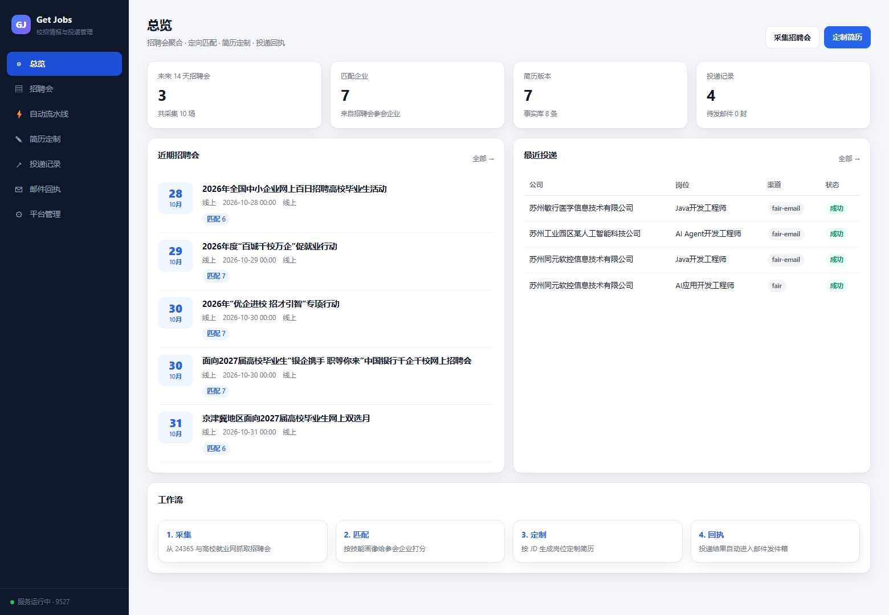
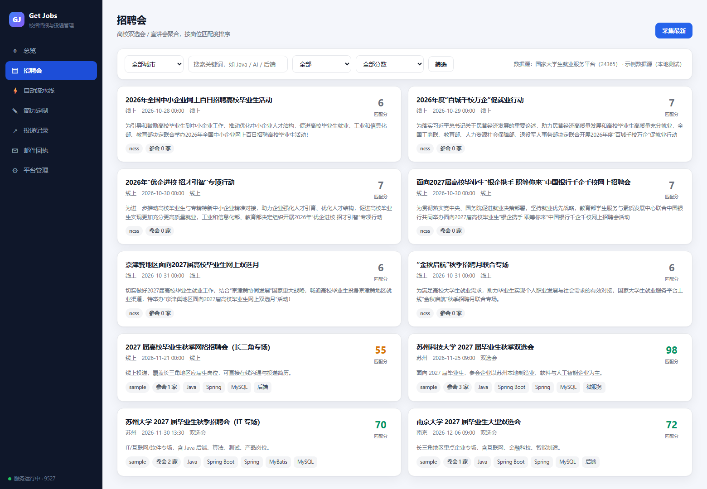
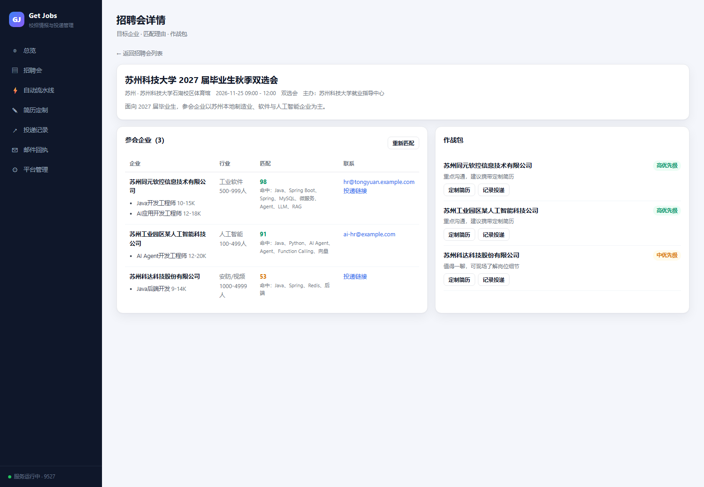
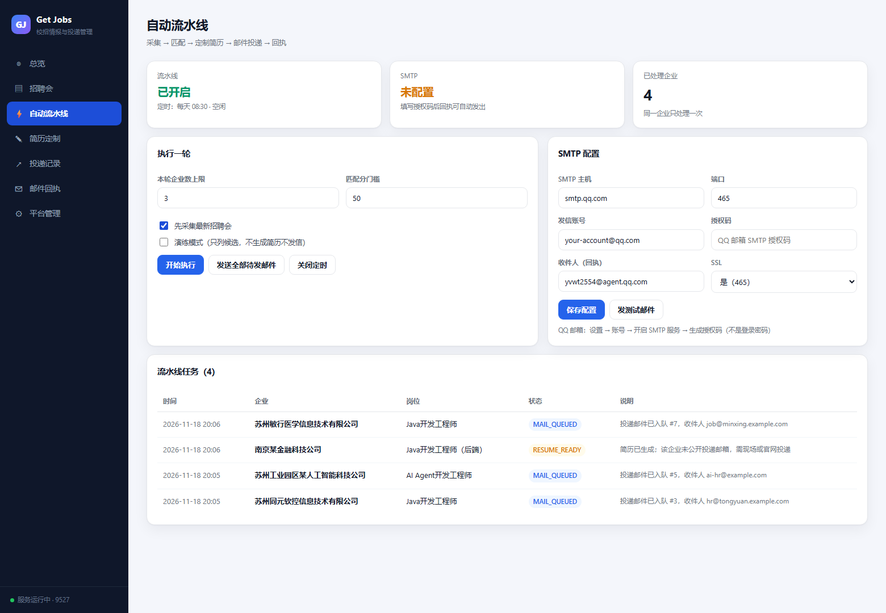
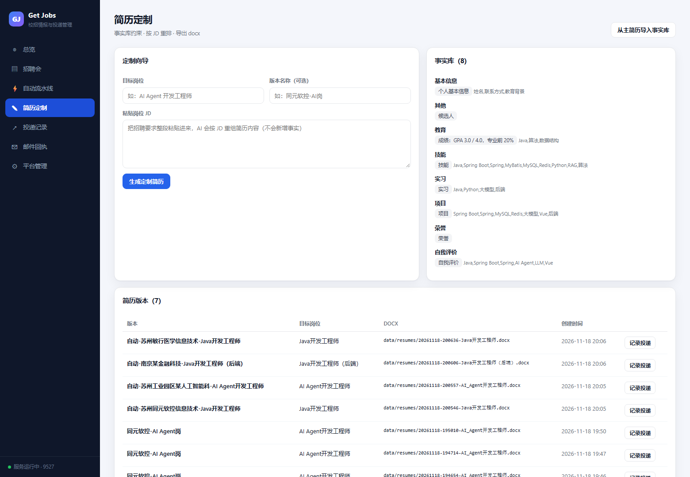
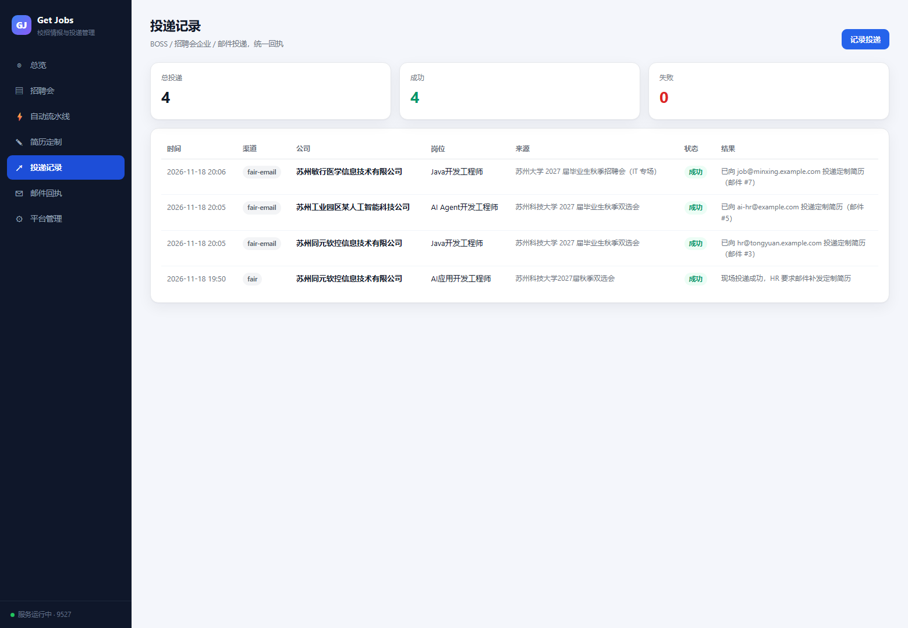
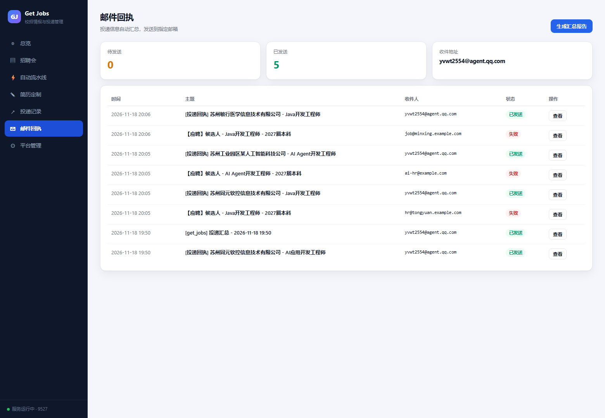
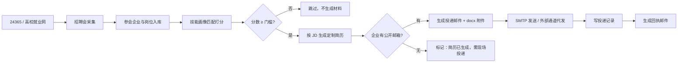

# 🎓 Get Jobs · 高校招聘会版

> 在 [loks666/get_jobs](https://github.com/loks666/get_jobs) 的「BOSS 直聘自动投递」之外，补齐
> **高校招聘会聚合 → 岗位匹配打分 → 按 JD 定制简历 → 邮件投递 → 回执反馈** 这条完整链路。

[](#-license)
[](https://adoptium.net/temurin/releases/?version=21)
[](https://spring.io/projects/spring-boot)
[](https://www.sqlite.org/)
[](https://api-docs.deepseek.com/)

---

## 为什么做这个 Fork

原项目解决的是「在 BOSS 上批量打招呼」，但对 2027 届校招来说，真正耗时间的不是打招呼，而是三件事：

1. **信息散**：24365、江苏 91job、各校就业网，每场双选会的参会企业和岗位都要自己一场一场翻；
2. **改简历累**：同一份简历投所有岗位，或者每个岗位手动改一遍措辞，前者没命中率，后者没效率；
3. **投完就断**：投了哪些、投给谁、用的哪版简历、HR 有没有回，全靠脑子和 Excel。

这个 Fork 把这三段接了起来：**每天自动把招聘会抓进来 → 按你的技能画像打分 → 只对值得去的企业生成定制简历 → 自动发投递邮件 → 回执汇总发到你邮箱**。

---

## 界面预览

原项目只有四个平台的配置页；本 Fork 把管理台重做成一套围绕「求职流程」的界面。

**总览**：今天有哪些会、匹配到几家企业、简历生成了几版、投递了多少份，一屏看完。



**招聘会**：双选会 / 宣讲会聚合列表，按匹配分排序，支持城市、关键词、来源筛选。



**招聘会详情（作战包）**：这场会有哪些企业、每家匹配多少分、命中哪些技能、还缺什么、该找谁投。



**自动流水线**：一条命令跑完采集 → 匹配 → 定制 → 投递 → 回执，也可只跑演练模式看结果不落地。



**简历定制**：左边粘 JD，右边是简历事实库，生成时只允许重组事实、不允许编造经历。



**投递记录**：每份投递的公司、岗位、渠道、所用简历版本、结果，统一留痕。



**邮件回执**：投递后自动生成回执邮件，可一键汇总成一份报告发到指定邮箱。



---

## 新增功能详解

### 1️⃣ 高校招聘会聚合

- **适配器模式**：`FairAdapter` 接口 + `NcssFairAdapter`（国家大学生就业服务平台 24365）+ `SampleFairAdapter`（本地示例源，便于离线调试）。
- **走接口而非抓页面**：24365 的列表页背后有 JSON 接口，直接请求拿到场次、时间、主办方、简介，比解析 HTML 稳得多，也不给学校站点增加负担。
- **每日 08:30 定时采集**：`@Scheduled` 触发，可用 `AUTO_PIPELINE_ENABLED` 开关控制；采集按 `site_code + external_id` 幂等 upsert，重复跑不会产生脏数据。
- **扩展新学校**：实现一个 `FairAdapter`（返回统一的场次结构）并注册为 Bean 即可，不需要改采集主流程。

```java
public interface FairAdapter {
    String siteCode();                       // 站点标识
    List<FairEventDTO> fetch();              // 拉取场次
}
```

### 2️⃣ 岗位匹配打分

- 技能画像来自**简历事实库的标签**（Java / Spring Boot / MyBatis / Redis / RAG / Agent…），不是写死的词表。
- 打分纯本地计算：**命中技能权重累加 + 岗位标题加权 + 城市匹配**，归一化到 0–98。不调用大模型，因此对几百家企业打分也不产生 token 成本。
- 输出不只是分数，还有 `matchedKeywords`（命中了什么）和 `missingSkills`（差什么），页面直接显示成「命中 / 待补」，这才是决定去不去这场会的依据。

### 3️⃣ 按 JD 定制简历

这是整条链路里最容易被做歪的一环——大多数「AI 改简历」本质上是在编经历。这里的做法是：

| 步骤 | 做法 |
|---|---|
| ① 结构化 | 解析主简历 docx，拆成 8 类事实（基本信息 / 教育 / 技能 / 实习 / 项目 / 荣誉 / 自我评价 / 其他）存进 `resume_fact` |
| ② 重组 | 只把**事实库原文**喂给模型，要求按 JD 调整顺序、突出相关技术点、改写措辞 |
| ③ 校验 | 生成结果里的每个项目名必须能在事实库中找到，否则拦截并重写；教育、奖项等硬信息不允许被改动 |
| ④ 导出 | 纯 Java（zip + OOXML）生成 docx，不依赖 POI，产物可直接投递 |

生成结果写入 `resume_version`，保留 JSON 结构与 docx 路径，便于回溯「这份投递给这家公司时用的是什么内容」。

### 4️⃣ 自动流水线

`POST /api/auto/run` 一次串起全流程：



几个刻意的设计：

- **幂等**：`auto_apply_task.company_id` 唯一，同一家企业只处理一次，重复执行不会重复投递；
- **演练模式**：`dryRun=true` 只跑匹配和筛选、不生成简历不发邮件，用来验证参数；
- **可中断**：每次执行有企业数上限（`maxItems`）和分数门槛（`minScore`），先把高分企业投完；
- **失败不阻塞**：单家企业失败只记 `FAILED` 和原因，继续处理下一家。

### 5️⃣ 投递记录与邮件回执

- 每次投递（BOSS、招聘会、邮件）统一写入 `delivery_record`，记录渠道、公司、岗位、来源、简历版本、状态、结果。
- 同时生成一封回执邮件进 `mail_outbox`，状态机为 `PENDING → SENT / FAILED`。
- 支持两种发送方式：
  - **系统内 SMTP**：填好邮箱授权码后由 Java 直接发（HTML 正文 + docx 附件）；
  - **外部通道代发**：应用先把邮件入队，由外部工具发送后调 `/api/mail/{id}/mark-sent` 回写状态。
- `POST /api/mail/report` 可把一段时间内的投递汇总成一份 HTML 报告（按状态统计 + 明细表）。

### 6️⃣ 管理台重构

- 原生 SPA（`index.html` + `ui/app.js` + `ui/app.css`），**零 npm 依赖、零构建步骤**，改完静态文件刷新即生效，避免为了几个页面引入一整条前端工具链。
- Hash 路由：总览 / 招聘会 / 招聘会详情 / 自动流水线 / 简历定制 / 投递记录 / 邮件回执 / 平台管理。
- 原有 BOSS、猎聘、智联、51job、AI 配置页全部保留，收进「平台管理」，不影响原功能。

---

## 技术实现

### 新增模块

```
src/main/java/com/getjobs/
├── application/
│   ├── controller/   Auto / Fair / Resume / Delivery / Mail / Dashboard
│   ├── service/      AutoApplyService（流水线编排）
│   │                 FairService（采集 + 匹配）
│   │                 ResumeService（事实库 + 定制 + docx）
│   │                 MailService（发件箱 + SMTP）
│   │                 DeliveryService（投递记录）
│   ├── entity/       fair_site / fair_event / fair_company
│   │                 resume_fact / resume_version
│   │                 delivery_record / mail_outbox / auto_apply_task
│   └── config/       SchemaInitializer（启动时幂等建表 + 补列）
├── worker/fair/      FairAdapter / NcssFairAdapter / SampleFairAdapter
src/main/resources/
├── schema.sql        扩展表建表脚本
└── dist/             新管理台
```

### 数据表

| 表 | 用途 |
|---|---|
| `fair_site` | 招聘会数据源（站点编码、名称、启用状态、上次采集时间） |
| `fair_event` | 招聘会场次（标题、起止时间、城市、主办方、来源链接） |
| `fair_company` | 参会企业及岗位（公司、行业、规模、岗位、薪资、HR 邮箱、匹配分） |
| `resume_fact` | 简历事实库（分类、标题、内容、标签） |
| `resume_version` | 定制简历版本（目标岗位、JSON 结构、docx 路径） |
| `delivery_record` | 投递记录（渠道、公司、岗位、来源、简历版本、状态、结果） |
| `mail_outbox` | 邮件发件箱（收件人、主题、正文、附件、状态、错误） |
| `auto_apply_task` | 流水线任务（企业、岗位、状态、说明，`company_id` 唯一） |

### 接口一览（新增）

```
GET  /api/dashboard                        总览统计
GET  /api/fair/sites                       数据源列表
POST /api/fair/crawl                       手动采集（siteCode=all 采集全部）
GET  /api/fair/list?days=120               场次列表（含匹配分）
GET  /api/fair/{id}                        场次详情 + 参会企业 + 作战包
POST /api/fair/{id}/match                  重新匹配打分
POST /api/resume/import-facts              从主简历导入事实库
GET  /api/resume/facts                     事实库列表
POST /api/resume/tailor                    按 JD 生成定制简历
GET  /api/resume/versions                  简历版本列表
GET  /api/auto/status                      流水线状态（开关、上次运行、已处理数）
POST /api/auto/run                         执行一轮（支持 crawl / maxItems / minScore / dryRun）
POST /api/auto/toggle                      定时流水线开关
GET  /api/auto/tasks                       流水线任务明细
POST /api/delivery/record                  记录一次投递（自动生成回执）
GET  /api/delivery/list                    投递记录
GET  /api/mail/outbox                      发件箱
GET  /api/mail/config                      邮件配置（授权码脱敏）
POST /api/mail/send-pending                批量发送待发邮件
POST /api/mail/report                      生成汇总报告
POST /api/mail/{id}/mark-sent|mark-failed  外部通道发送后回写状态
```

---

## 快速开始

前置：**JDK 21**、可用的 SQLite 数据库文件（`db/getjobs.db`，可从原项目 release 下载模板）。

```bash
# 1. 编译
./gradlew build -x test

# 2. 启动（Windows 可双击 start.bat，会自动指定 JDK 21 与端口）
./gradlew bootRun --args='--server.port=9527'
```

浏览器打开 <http://localhost:9527>。

首次使用顺序：

1. **简历定制 → 从主简历导入事实库**：解析 docx，建立技能画像（匹配打分依赖这一步）；
2. **自动流水线 → SMTP 配置**（可选）：填邮箱授权码后回执可自动发出；
3. **招聘会 → 采集最新**：先把场次拉进来看看；
4. **自动流水线 → 开始执行**：建议先勾「演练模式」跑一次，确认筛选结果符合预期再正式跑。

### 关键配置（`config` 表）

| 键 | 说明 |
|---|---|
| `BASE_URL` / `API_KEY` / `MODEL` | 大模型接口，填任意兼容 OpenAI 格式的地址（默认 DeepSeek） |
| `MAIL_HOST` / `MAIL_PORT` / `MAIL_SSL` | SMTP 服务器（QQ 邮箱为 `smtp.qq.com:465`） |
| `MAIL_USERNAME` / `MAIL_AUTH_CODE` | 发信账号与**授权码**（QQ 邮箱不是登录密码） |
| `MAIL_TO` / `MAIL_FEEDBACK_TO` | 投递回执收件地址 |
| `AUTO_PIPELINE_ENABLED` | `1` 开启每日 08:30 定时流水线，`0` 仅手动执行 |

---

## 已知限制（如实说明）

- **自动投递只覆盖两条路径**：BOSS 直聘（原项目能力）与「企业公开了投递邮箱」的岗位。前程无忧、智联的脚本上游已失效，猎聘存在导航竞态未修复。
- **高校就业网只接了一个真实源**（24365）。各校就业网结构差异大、改版频繁，需要按 `FairAdapter` 逐个适配，这部分是长期维护成本。
- **24365 接口不返回城市字段**，因此部分场次城市显示为「线上」。
- **定时任务依赖进程常驻**：应用没启动时不会执行，需要长期运行建议挂到常驻机器或用系统计划任务拉起。
- **不做验证码绕过、不伪造身份**：需要登录校招系统的岗位只生成材料清单和提醒，最终提交由人完成。

---

## 与原项目的关系

本仓库是 [loks666/get_jobs](https://github.com/loks666/get_jobs) 的二次开发分支，**保留并兼容原有全部能力**：

| 能力 | 原项目 | 本 Fork |
|---|---|---|
| BOSS 直聘自动投递 | ✅ | ✅ 保留（含 AI 打招呼、图片简历、每日上限） |
| 猎聘 / 51job / 智联 | 部分失效 | 保留配置页，脚本未改动 |
| 高校招聘会聚合 | ❌ | ✅ 24365 真实接口 + 适配器框架 + 定时采集 |
| 岗位匹配打分 | ❌ | ✅ 基于简历事实库的技能画像打分 |
| 按 JD 定制简历 | ❌ | ✅ 事实约束 + 一致性校验 + docx 导出 |
| 端到端流水线 | ❌ | ✅ 采集 → 匹配 → 定制 → 投递 → 回执 |
| 投递记录与邮件回执 | 企业微信推送 | ✅ 投递台账 + 回执邮件 + 汇总报告 |
| 管理台 | 各平台独立配置页 | ✅ 围绕求职流程重做，原页面收进「平台管理」 |

原项目的安装、环境配置、各平台细节文档仍然适用，见 [原项目 Wiki](https://github.com/loks666/get_jobs/wiki)。

---

## License

本项目遵循原项目的 **PolyForm Noncommercial License 1.0.0**，**仅限非商业用途**，商业授权请联系原作者。
原项目版权归 [loks666](https://github.com/loks666) 所有；本仓库新增部分同样以该协议开源。

## 免责声明

本工具仅用于个人求职效率提升：只抓取公开页面、只向公开发布的投递邮箱发送、不做验证码绕过、不伪造身份。
使用者需自行遵守目标网站的服务条款，并承担账号被限制等风险。
